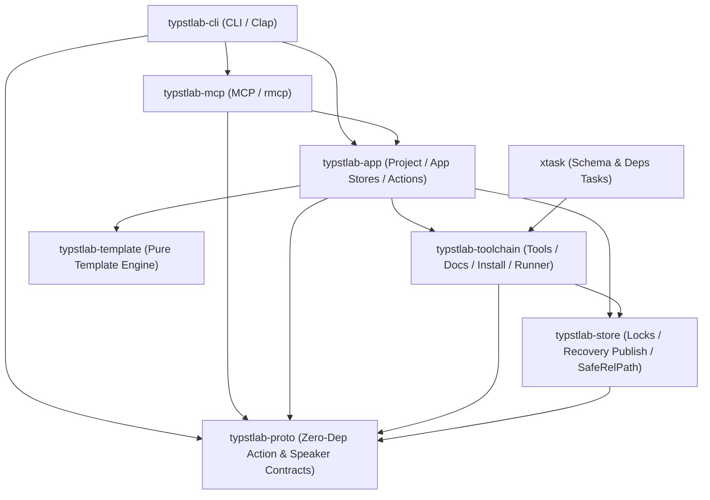

# typstlab アーキテクチャ設計書（確定仕様）

> **位置づけ**: 本ドキュメントは、旧 `typstlab-base` および旧 `typstlab-proto::models` を前提としない `typstlab` の**新アーキテクチャ最終形**を言語化した確定仕様書である。実装および段階的 PR のすべては本設計書を基準とする。

---

## 1. 目的と対象範囲

### 1.1 解決したい課題
現在の `architecture-overhaul` ブランチには新旧の設計が混在し、以下の構造的課題が顕在化している。

1. **旧基盤の肥大化と二重管理**: `typstlab-base` に旧ツールチェイン実装（`driver.rs`, `install/`, `version_resolver.rs`, `docs_parser/`）と新規の `template_engine` / `PathIncludes` が同居し、`typstlab-toolchain` との境界が曖昧になっている。
2. **過剰な抽象化と UI 漏洩**: `typstlab-proto` に、実体と合わない可逆プロトコル（`LockToDefinition`）、物理パスを露出させる `HasRoot` / `StoreEntryAddress`、UI 表示都合を含む `AppEvent`（`EventAudience` / `EventPresentation`）、重複した `CliSpeaker` / `McpSpeaker`、さらに失敗時にも成果物型を抱え・不整合状態を許す `ArtifactResult`（`bool + Option`）が混在している。
3. **安全性・並行性・再現性の不備**:
   - `BuildAction` がコンパイル前に `remove_dir_all` で前回成果物を削除するため、ビルド失敗で前回の成果物まで失われ、しかも `pdf` (`dist/<paper>/`) と `png` (`dist/<paper>/png/`) の階層衝突で他フォーマットを巻き添え削除する。
   - `project_docs.rs` の 2 回 `rename` 置換が `TempDir` バックアップに依存しており、復元失敗時の `Drop` で旧データを削除し得るほか、公開後の掃除失敗で呼び出し側が公開成否を判定できない。
   - ストア操作にプロセス間排他／共有ロックがなく、MCP の `build_and_render` が公開後の可変パスを開き直すため、同時実行で別リクエストのページが混在・欠落し得る。
   - `MCP` のキャンセル（`RequestContext::ct`）がブロッキング実行や外部子プロセスに届かない。
   - `TypstDriver` が毎回 `--version` を起動し、`cwd` / `env` / `stdin` / `OsString` や常駐・透過実行を扱えない。
   - `ToolchainBinaryStore` が未対応プラットフォームを `"unsupported"` 文字列へ潰し、`resolve` / `commit` 時の実体・真正性検証が抜けている。
   - `template_engine` の `Value` デシリアライズで TOML 日付が失敗し、`{{ name }}` の生文字列差し込みが Typst 構文破壊を起こし得る。

### 1.2 目標
「動く」だけでなく、以下の性質を構造レベルで保証するアーキテクチャへ移行する。

- **壊れない（安全性）**: 同一親ディレクトリ上の staging → 固定名バックアップ → 公開確定と冪等復旧による **復旧可能な置換（crash-recoverable publish）**、排他／共有ロック、字句検証と実 FS 封じ込めの分離。
- **再現可能（決定的）**: 明示的な `cwd` と環境変数隔離、ハッシュ検証付き取得、確定バージョンに基づくガード判定。
- **拡張しやすい**: 将来の `typstyle` / LSP（`tinymist` 等）/ `test` の追加や将来の hooks 導入に耐える一方向依存。
- **コードを読むだけで意図が追える**: 散在する `read_dir` や添字アクセスを排し、純粋なルール変換と明確なメッセージ（具象 `Store` 操作・`Action`・`Speaker`）で表現する。
- **常に緑の移行**: `typstlab-base` の廃止は移行完了の結果として行い、すべての PR でビルドと全テストを通し続ける。

---

## 2. 設計原則（4 本柱）

### 原則 1: Functional Core, Imperative Shell
- **内側（Functional Core）**: 設定解決、互換性判定、コマンド構築、テンプレート構文解析・解決・描画、HTML/JSON docs から Markdown への変換には、**ファイル I/O や外部プロセス起動を一切含めない**。決定的な純粋関数・型変換パイプラインとして実装する。
- **外側（Imperative Shell）**: ディレクトリ公開には OS のファイルシステム特性を踏まえ、2 回 `rename` を「原子的／ACID」と過大表現せず、**「復旧可能な置換（crash-recoverable publish）」**として厳密に定義・実装する（保証対象はローカル FS 上の協調プロセスおよびプロセス異常終了であり、電源断時の `fsync` 耐久性は別レイヤーの課題として分離する）。

### 原則 2: 関数型のルール × OO のメッセージ × 最小の Trait
- **Trait 導入の基準**: 「2 つ以上の具象型に対して共通アルゴリズムや境界契約が動く場所」にのみ Trait を定義する。呼び出し側で共通処理しない対称化 Trait や単なるラベル Trait は作らない。
- **型の表現力**: 「あり得ない状態」を型レベルで表現不能にする。成否は標準 `Result`（複数対象なら対象別 `Result` の集合である `BuildReport`）で表し、`bool + Option` を排除する。
- **読みやすさ**: 生の `PathBuf` 結合や配列添字、散在する `fs::read_dir` を避け、ドメイン型・検証済み相対パス・メッセージメソッドで処理の意図を表現する。

### 原則 3: RDB 的な `Store` 統一モデル（契約の一貫性と意味論の明示）
- 6 種の Store に同一の書き込み Trait を先に課すことはせず、**操作体系の統一感（「キーで `resolve`、必要なら `list`、非 `Clone` の `staging` で準備し、意味論を冠した具象メソッドで確定」）** を採用する。
- 物理配置・ロック・復旧・検証といった共通機構は `typstlab-store` エンジンに集約し、衝突時の振る舞い（重複エラー `insert`／競合再利用 `install_if_absent`／復旧付き置換 `publish`）はメソッド名で明確に区別する。`resolve` を複数 Store でジェネリックに扱う実例が生じた時点で `StoreLookup` を導入する。

### 原則 4: `serde` による設定スキーマのドメイン委譲と合成
- `typstlab-toolchain` や `typstlab-template` が自身の設定セクションの型・デシリアライズ・バリデーションを所有する。
- `typstlab-app` の `*Config` は変換層を置かず `serde` 合成によって各エンジンの型をそのまま吸収する（旧形式との互換正規化のみ読み込み境界で行う）。

---

## 3. ワークスペース構成と依存グラフ（DAG）

長期設計として **7 クレート構成（＋開発補助 `xtask`）** を採用する。ツールごと（1 ツール 1 クレート）に分割しない理由は、取得・展開・検証・キャッシュ・実行のライフサイクルをツール間で共有でき、配布バイナリも単一の `typstlab` CLI にまとまるため、クレート間 API 維持コストに見合う独立性が得られないからである。ツール定義は `typstlab-toolchain` 内の私有モジュール（Layer 2）として閉じ、将来別バイナリ分離や重い依存の隔離が必要になった時点で抽出する。

`typstlab-base` は移行の最終段階で**完全に廃止**する。



> **補足**: `typstlab mcp stdio` サブコマンドを起動するため、`typstlab-cli --> typstlab-mcp` のエッジを明示的に許可する。`typstlab-mcp` から `typstlab-cli` への逆参照は禁止する。

### クレート別責務一覧

| クレート | 位置づけ | 主な責務 | 依存できる先 |
|---|---|---|---|
| `typstlab-proto` | 会話の憲法（依存ゼロ） | クレート境界を越える実行・通知契約（`Action`, `ActionNotice`, `Speaker`, `run_with`）および最小限の共有定数 | **なし（normal/build/dev すべて外部依存ゼロ）** |
| `typstlab-store` | 物理 FS エンジン | プロセス間排他／共有ロック、キー正規化・ルート識別、非 `Clone` staging、復旧可能置換（`publish`）と新規確定、`SafeRelPath`、実 FS 封じ込め、`PathIncludes` | `typstlab-proto`（任意）または独立葉 |
| `typstlab-toolchain` | 外界の隔離層 | ツール明示登録、互換表・解決、配布物ハッシュ検証、取得・展開、キャッシュ Store（`BinaryStore` / `DocsCacheStore`）、内部 `ProcessSpec`・`BinaryRunner`、docs 変換、外向けファサード | `typstlab-proto`, `typstlab-store` |
| `typstlab-template` | 純粋計算エンジン | テンプレート AST 解析、全ファイル横断スキーマ検証、パラメータ優先度解決、Typst 文字列リテラルエンコード、安全文字表示 `{{ name }}` とコードリテラル `{{= name }}` の描画（I/O ゼロ） | 汎用クレートのみ（`chrono`, `serde`, `thiserror`, `toml`） |
| `typstlab-app` | アプリケーション層 | `Project` コンテナ（旧設定正規化含む）、`PaperStore` / `TemplateStore` / `DistStore` / `ProjectDocsStore`、ユースケース `Action` 群 | `typstlab-proto`, `typstlab-store`, `typstlab-toolchain`, `typstlab-template` |
| `typstlab-cli` | CLI アダプタ | サブコマンド定義（`clap`）、MCP 起動、`Speaker` 実装、終了コード制御 | `typstlab-app`, `typstlab-mcp`, `typstlab-proto` |
| `typstlab-mcp` | MCP アダプタ | `rmcp` ツール定義、`RequestContext::ct` によるキャンセル・進捗・並列数制限、`Speaker` 実装、PNG の安全読み取りと base64 応答 | `typstlab-app`, `typstlab-proto` |
| `xtask` | 開発補助 CLI | `json_check`, `check_docs_schema` に加え、`deps-graph` / `deps-check` | `typstlab-toolchain`（および `cargo metadata` 実行） |

### 厳守すべき依存禁止ルール
1. **層飛び越し禁止**: `typstlab-cli` および `typstlab-mcp` は、設計上許可された `typstlab-app`（CLI のみ `typstlab-mcp` も可）と `typstlab-proto` のみを参照する。`typstlab-toolchain` / `typstlab-template` / `typstlab-store` を直接呼び出さない。
2. **横並び非依存**: `typstlab-toolchain` と `typstlab-template` は互いに依存しない。
3. **純粋性保護**: `typstlab-template` は `typstlab-proto` / `typstlab-store` / `std::fs` を参照しない完全な Functional Core とする。
4. **ゼロ依存維持**: `typstlab-proto` は normal / build / dev の全依存で外部クレートを持たない。

### `xtask deps-graph` と `deps-check`
既存の `json_check`・`check_docs_schema`（snake_case）は後方互換のため維持しつつ、新規に `deps-graph` と `deps-check` を追加する。

- **共通入力**: `cargo metadata --format-version 1 --no-deps --locked` の宣言グラフをパースし、`workspace_members` と各パッケージの `manifest_path` / 依存 `path` を照合する。依存名の別名（rename）、`optional`、target 条件、および `normal` / `build` / `dev` の全種別を保持する。
- **`deps-graph`**: ノードと辺を決定的にソートし、孤立ノードも含めて Mermaid `flowchart TD` を標準出力へ出力する。設計書の図は本出力を正本として保つ。
- **`deps-check`**: 許可エッジ表（`cli -> mcp` を含む上記 DAG）に対して検査し、禁止エッジを依存種別・target 条件・manifest パス付きで報告する。未知のワークスペースメンバーもエラーとし、`typstlab-proto` の外部依存ゼロを normal/build/dev 全体で強制する。移行途中に一時的な辺を許容する場合は、削除担当の移行 PR をコード内コメントで明記する。

---

## 4. `typstlab-proto` 仕様

`typstlab-proto` は **クレートを跨ぐ会話プロトコル（`Action`, `ActionNotice`, `Speaker`, `run_with`）** に専念し、`std::path` を一切含めない。

### 4.1 コンパイル確認済みの最終契約

```rust
pub enum ActionNotice<E, W> {
    Event(E),
    Warning(W),
}

pub trait Action: Sized {
    type Output;
    type Event;
    type Warning;
    type Error: std::error::Error + 'static;

    fn run(
        self,
        notify: &mut dyn FnMut(ActionNotice<Self::Event, Self::Warning>),
    ) -> Result<Self::Output, Self::Error>;
}

pub trait Speaker<A: Action>: Sized {
    type Response;

    fn on_notice(&mut self, notice: ActionNotice<A::Event, A::Warning>);
    fn finish(self, result: Result<A::Output, A::Error>) -> Self::Response;
}

pub fn run_with<A: Action, S: Speaker<A>>(action: A, mut speaker: S) -> S::Response {
    let result = action.run(&mut |notice| speaker.on_notice(notice));
    speaker.finish(result)
}
```

- **単一クロージャ設計の理由**: `monitor` と `warning` を 2 つの `&mut dyn FnMut` に分けると、呼び出し側で両方から `speaker` を可変借用できずコンパイル不能になる。`ActionNotice<E, W>` にまとめることで、単一クロージャ `&mut |notice| speaker.on_notice(notice)` として素直に借用でき、将来 `notice` の種類が増えてもシグネチャが壊れない。
- **部分成功の表現**: 複数ターゲットを扱う `BuildAction` は `Output = BuildReport` を返し、`(PaperId, BuildFormat)` ごとの `Result<BuildArtifact, ArtifactFailure>` を保持する。外側の `Action::Error` は「プロジェクト読込失敗やストアロック不能など、処理全体を中断させるエラー」のみを表す。CLI の `Speaker` は部分失敗を含む場合に非ゼロ終了コードを返し、MCP の `Speaker` は対象ごとの成否を構造化して返す。
- **エラーの情報粒度**: Store・Toolchain 等の型付きエラーは、対象キー・操作名・元エラー（`source`）を保持し、`NotFound`、破損（`Corrupted`）、ロック待ち期限切れ（`LockTimeout`）、キャンセル（`Cancelled`）、復旧要（`RecoveryRequired`）を型で区別する。
- **キャンセル・期限・非同期境界**: 期限（`Deadline`）とキャンセルフラグ／トークンはそれが必要な Action の入力に持たせる。`Send` 境界は `Action` Trait 自体には強制せず、MCP サーバーのワーカー（`spawn_blocking` 等）境界で課す。

### 4.2 現行 `typstlab-proto` ファイルの整理対応表

| 現行ファイル | 新設計での扱い | 理由 |
|---|---|---|
| `action.rs` | **改訂・残置** | `AppEvent` を廃し `ActionNotice<Event, Warning>` 1 本へ変更 |
| `speaker.rs` | **刷新** | `CliSpeaker`/`McpSpeaker` を `Speaker<A>` + `run_with` へ統合 |
| `store.rs` | **廃止** | 6 種 Store に統一書き込み Trait を課さず、具象メソッド規約＋`typstlab-store` 共通基盤へ移行（`StoreLookup` は必要時に導入） |
| `event.rs` | **削除** | `EventAudience` / `EventPresentation` 等の UI 都合をドメイン層から排除 |
| `artifact_result.rs` | **削除** | `bool + Option` を廃止し、`BuildReport` 内の標準 `Result` へ移行 |
| `artifact.rs` | **`typstlab-app` へ下ろす** | `build` 専用の具象型 `BuildArtifact` として表現 |
| `install.rs` | **`typstlab-toolchain` へ移動** | 取得・アーカイブ展開仕様は `toolchain` 固有の責務 |
| `path.rs`, `config.rs` | **削除** | 探索と設定解決は各 Store と `Project::open` 等へ吸収、`LockToDefinition` を廃止 |
| `models/*`, `macros.rs` | **削除** | 旧設計の残骸（最後の利用箇所を移行した PR で削除） |

---

## 5. RDB 的 `Store` 設計と `typstlab-store`

`typstlab-store` は「物理レイアウト・ロック・staging・復旧可能置換・安全性境界」の実装エンジンを一手に担う。

### 5.1 ロックとキー／ID 正規化規則
- **ロック配置とライフサイクル**:
  - プロジェクト配下: `<project>/.typstlab/locks/<store>/<key>.lock`
  - 共有キャッシュ配下: `<cache>/locks/<store>/<key>.lock`
  - 複合キーは成分ごとに階層化する（例: `dist/report/pdf.lock`）。
  - ロックファイルは `O_TRUNC` せず開き、通常のキャッシュ／一時領域掃除の対象から除外する。
  - ロック待ちには期限（タイムアウト）とキャンセル確認を設け、Windows のファイル共有違反（sharing violation）に対してのみ短時間の指数バックオフ再試行を行う。アクセス権限エラーと競合エラーは明確に区別する。
- **ルート実体識別と重複拒否**:
  - Store ルートは実 FS 上のディレクトリ実体として識別し、`papers_dir`・`dist_dir`・`templates_dir`・`.typstlab` 等の Store ルート同士、または内部領域同士の重複・包含関係、および symlink / junction 経由の別名参照を初期化時に拒否する。
- **ID / キー正規化規則**:
  - ID（`PaperId`, `TemplateId`, `tool_id` 等）は **ASCII 英数字で始まる単一パス成分**とし、使用可能文字は `[A-Za-z0-9._-]` に限定する。末尾の `.` および拡張子より前の部分が Windows 予約名（`CON`, `PRN`, `AUX`, `NUL`, `COM1`〜`COM9`, `LPT1`〜`LPT9`、大文字小文字非区別）に該当する名前を拒否する。
  - 論理 ID は全 OS で ASCII 小文字へ正規化してキー・ロックに用いる。既存ディレクトリの実名は維持しつつ、同じ正規キーへ複数の実名が対応する衝突や、規則外の既存ディレクトリ名が見つかった場合は、対象パスと修正方法を示したエラーで移行を案内する。
  - バージョンキーは SemVer の正規表記を用い、大文字を含むプリリリース／メタデータがある場合のみ `v-<lowercase-hex>` で符号化して Windows 上の大文字小文字衝突を防ぐ。

### 5.2 非 `Clone` Staging ハンドルと操作フロー
- `stage` が返すハンドルは非 `Clone` であり、以下を内部に保持する：
  - 私有の `TempDir`（対象 Store 直下の `.tmp/` 等、対象と同じマウントポイント上に作成）
  - 作成元 Store・ルート識別子
  - 正規化済みキー
  - 宛先親ディレクトリの識別子
- **重要ルール: 生成中・ダウンロード中・コンパイル中にロックを持たない。** 確定メソッド（`insert` / `install_if_absent` / `publish`）がハンドルを所有権消費し、以下の順で確定を行う：
  1. ロック外で staging 内の完了物（ファイル存在・形式・数値順等）を検証する。
  2. 該当キーの排他ロックを取得する。
  3. 作成元・キー・宛先親ディレクトリ・staging の実体一致を再照合し、状態確認・復旧・衝突判定を行う。
  4. 公開開始直前に最後のキャンセル確認を行う（一度公開を開始したら公開完了または復旧まで中断しない）。

### 5.3 復旧可能な置換（Crash-Recoverable Publish）の状態機械
`backup` は **`dest` と同じ親ディレクトリに置くキーごとの固定名**（例: `.<key>.backup`）とし、自動削除（`TempDir` 等）の対象から完全に外す。排他ロック取得後、`metadata` で状態を確認する際、**「なし」と判定してよいのは `ErrorKind::NotFound` のみ**であり、権限エラーや想定外のファイル種別は即エラーにする。

| `dest` | `backup` | 排他ロック下での動作 |
|---|---|---|
| なし | なし | 未公開。新規公開を開始できる。 |
| あり | なし | 正常状態。現在の成果物を利用可能。 |
| なし | あり | 前回置換の中断残骸。`backup -> dest` へ復元する。失敗時は `backup` を残したまま `RecoveryRequired` を返す。 |
| あり | あり | 前回は新版 `dest` の公開まで成功済み。`backup` を一意な掃除用ディレクトリ名へリネームして固定名スロットを空け、再帰削除はロックの外で行う（移動不能なら固定 `backup` が空くまで次の置換を開始しない）。 |

**置換手順**:
1. 必要に応じ上記状態機械で事前復旧・掃除用リネームを完了させる。
2. `dest -> backup` にリネーム。
3. `staging -> dest` にリネーム（**ここが公開確定点**）。
4. ステップ 3 が失敗した場合は同じ排他ロック下で `backup -> dest` を復元し、復元も失敗したら両方の原因と `backup` パスを含むエラーを返す。
5. ステップ 3 が成功した後の `backup` 削除（または一意掃除用名への退避後の削除）の失敗は **成功に付随する警告** として返し、呼び出し側に「公開済みである事実」を失わせない。

**読み取り時のロック契約**:
- 読み取りは **共有ロック** を取得し、読み取り処理の完了まで保持する。
- 共有ロック中に `dest` 欠落かつ `backup` 存在等の不整合を検知した場合は、**共有ロックを解放してから排他ロックを取得し直し、状態を再確認した上で復旧**を行う。

### 5.4 字句検証と実 FS 封じ込めの分離
`SafeRelPath` に FS 封じ込めまで背負わせると、`canonicalize` や TOCTOU・symlink 攻撃に脆弱になるため責務を分離する。
- **字句検証（Pure）**: 区切り文字（`/` / `\`）・ドライブプレフィックス・`..`・Windows 予約名・ADS（Alternate Data Streams, `:`）・末尾空白や末尾ドット・正規化後のパス衝突を検査する。`output_name` や ID は単一成分に限定する。
- **実 FS 封じ込め（I/O）**: テンプレート・アーカイブ・プロジェクト操作において、通常ファイルとディレクトリのみを許可し、symlink・junction・reparse point・重複アーカイブエントリを拒否し、展開サイズ上限を課す。

### 5.5 全 6 種の Store 一覧と `DistStore` の設計

| Store 名（所属） | キー | 確定メソッド（衝突時の意味論） | `commit` 前検証 | 物理レイアウト |
|---|---|---|---|---|
| `BinaryStore` (`toolchain`) | `(tool_id, version, platform/abi)` | `install_if_absent`（競合時は勝者を検証して再利用） | 実行ファイル存在・ハッシュ確認・`VersionProbe` 一致 | `<cache>/binary/<tool>/<ver_key>/<target>/` |
| `DocsCacheStore` (`toolchain`) | `(docs_id, version, transform_rev)` | `install_if_absent`（競合時は勝者を検証して再利用） | 変換済みファイル数 > 0 確認 | `<cache>/docs/<docs_id>/<ver_key>/r<rev>/` |
| `ProjectDocsStore` (`app`) | `docs_id` | `publish`（復旧可能置換） | 非空ファイル群確認 | `<project>/.typstlab/docs/<docs_id>/` |
| `PaperStore` (`app`) | `PaperId` | `insert`（既存衝突は `AlreadyExists`） | `paper.toml` 妥当性＋`entry_point` 検証 | `<papers_dir>/<paper_id>/` |
| `TemplateStore` (`app`) | `TemplateId` | `insert`（既存衝突は `AlreadyExists`） | `template.toml` 妥当性＋`entry` 存在確認 | `<templates_dir>/<template_id>/` |
| `DistStore` (`app`) | `(PaperId, BuildFormat)` | `publish`（復旧可能置換） | 出力検証・ページ連番検証 | `<dist_dir>/<paper_id>/<format>/` |

#### `DistStore` と MCP `build_and_render` のレース対策
- **レイアウト統一**: PDF も `dist/<paper>/pdf/<output_name>.pdf` に統一する（`(PaperId, BuildFormat)` と物理単位を 1 対 1 にし、`output_name` 変更時の旧ファイル残留や PNG 等との干渉を根絶）。
- **公開前検証**: 現行 `BuildAction` の `entries.flatten()` と文字列ソート（ページ 10 が 2 より前になる不具合）を廃止し、通常ファイルであること、単一ファイル名・ページ番号の連続性と数値順ソートを公開前に検証する。
- **MCP 安全読み取り**: MCP がビルド直後に公開パスを開き直すと別リクエストの同時ビルドでページがすり替わり得るため、**公開前の検証済み staging から上限付きで所有済み PNG バイト列を順に読み込み、排他ロック下での公開成功確定後、ロック外で base64 エンコードして返却**する。CLI には公開された宛先パスを返す。

---

## 6. `typstlab-toolchain` 仕様

### 6.1 責務と 6 レイヤーの一方向依存
外部ツール・外部ドキュメントに関するすべて（定義・登録・互換解決・配布元とハッシュ検証・取得展開・キャッシュ Store・プロセス実行・docs 変換）を `typstlab-toolchain` に閉じ込める。

```text
Layer 5 [Facade]       : runtime (ToolchainManager / ResolvedBinary / ResolvedDocsTree)
Layer 4 [I/O Shell]    : store (BinaryStore, DocsCacheStore), install (Fetcher + SafeExtract), runner (BinaryRunner)
Layer 3 [Policy/Plan]  : registry, tool_choices, toolchain_spec, resolver
Layer 2 [Tool Defs]    : (私有) binary::typst, docs::typst, 将来の typstyle / tinymist
Layer 1 [Protocols]    : version_resolution, tool (ToolchainTool), binary::command, binary (trait), docs (trait)
Layer 0 [Primitives]   : platform, error
```

### 6.2 確定した設計方針と是正事項
1. **明示配列登録への統一（`build.rs` 廃止）**:
   - 現行 `binary/mod.rs` の `build.rs` 自動生成を廃止し、登録モジュール（Layer 3）で `TOOLS` / `DOCS` を明示配列として宣言する。ID 一意性・互換表パース・全プラットフォーム配布解決・コマンド契約をテストで保証する。これにより、Layer 1 の公開モジュールが Layer 2 を抱え込む構造も解消する。
2. **依存逆流とフォールバックの解消**:
   - `tool_choices.rs` から `crate::binary::typst` への依存を外して純粋な `(id -> ToolChoice)` マップとし、`typst` 明示バージョン必須の検証は `ToolchainSpec::validate()` へ移す。
   - `"unsupported"` 文字列フォールバックを廃止し、`Platform::target_triple()`（および必要に応じ ABI / libc 条件を含むターゲット識別子）が `Result<&'static str, ToolchainError>` を返す。
3. **取得物の真正性・キャッシュ検証・変換リビジョン**:
   - 信頼できる配布元と検証済みハッシュ（チェックサム／署名等）で真正性を確認した後に `VersionProbe` を実行し、バージョン一致を確かめてから `BinaryStore` に確定する。
   - キャッシュヒット時にも期待する実行ファイル構造を検証し、空ディレクトリや破損キャッシュを弾く。
   - `DocsCacheStore` のキーにはパーサの変換リビジョンを含め、Markdown 変換仕様変更時に古いキャッシュと衝突しないようにする。
4. **バージョン互換解決**:
   - `auto` の選択順（互換配列内の最大 SemVer）、明示バージョンの互換チェック（`NotFound` vs `Incompatible`）、`none`、該当なしを `resolver` に実装してテストで固定する。
5. **ファサードと実行エンジン (`BinaryRunner`)**:
   - `ProcessSpec` 生成と実行は `typstlab-toolchain` のファサード内部に隠蔽し、上位（`typstlab-app`）へは型付きコマンド操作（例: `compile`, `query`, `init`）のみを公開する。生引数の透過実行が必要な場合は明示的な CLI 操作に閉じ、外部プロセス自体を隔離する必要がある場合は OS サンドボックスを用いる。
   - 実行設定を固定する保証（固定バイナリ・`cwd`・隔離 `env`・`OsString` 引数・オプション単位 `VersionGuard`）と、外部要因（システムフォント・オンライン Typst パッケージ・現在時刻）まで同一出力を再現する保証は区別して文書化する。
   - `BinaryRunner` は未指定の `stdin` を即クローズし、`stdout`/`stderr` を並行ドレインして出力サイズ上限を課し、キャンセル・タイムアウト時に子プロセス（子孫を産むモードではプロセスグループ / Windows Job Object）を確実に終了・回収する。生 `Child` を返す `spawn` API は実際の利用者（LSP 等）を導入する時点で設計する。

---

## 7. `typstlab-template` 仕様

現行 `crates/typstlab-base/src/template_engine/` を I/O ゼロの独立クレート `crates/typstlab-template` として切り出す。

### 7.1 `{{ name }}` と `{{= name }}` の厳密な意味論
- **`{{ name }}`（マークアップ位置専用の文字表示）**:
  - 生文字列の無防備な差し込みは採用しない。`= {{ title }}` と自然に書いた際に、値に `#`, `*`, `_`, `[`, `]`, `<`, `>`, `@`, `$`, `\`, `//`, `/* */` や改行・引用符が含まれても Typst 構文が変わらないよう、**Typst 用文字列リテラルエンコーダーを通して `#("...")` として挿入する**。
  - サポート位置はマークアップ位置専用とし、Typst の文字列リテラル内やコメント内への差し込みはサポート対象外と明記する。
- **`{{= name }}`（コード位置専用の型付きリテラル）**:
  - `#let authors = {{= authors }}` などのコード位置で、Typst リテラル（文字列・整数・真偽値・`datetime(...)`・配列）を生成する。文字列エンコーダーは `{{ name }}` と共有する。

### 7.2 TOML デシリアライズと検証仕様
- **`Value::Date`**: TOML のローカル日付（例: `2026-05-22`）のみを `Value::Date(NaiveDate)` として受け取り、`"2026-05-22"` は常に `Value::String` として扱う。時刻・日時・オフセット付き日時は拒否する。`Params`、配列要素、`ParamDefault::Literal` を含めすべてネイティブ TOML 日付として往復させる（`serde(untagged)` 任せの `String` 誤マッチを防ぐ専用 visitor / deserializer を用いる）。
- **`ValueType::Array`**: `type = { array = "string" }`、ネスト時は `type = { array = { array = "date" } }` としてデシリアライズし、値は通常の TOML 配列から要素型を再帰検証する。
- **全体検証・日付固定・バイナリ区分**:
  - 未使用入力の警告はテンプレート内の単一ファイルではなく、**テンプレート全体（全テキストファイル）の AST を横断して判定**する。
  - `required = false` かつデフォルト無しの任意入力がテンプレート内で参照されている場合は、ファイル位置付きのエラーとする。
  - `builtin.today` は `Action` 開始時に一度だけ取得した日付を注入する。
  - テンプレート収集時に「テキストとしてテンプレート展開するファイル」と「そのままバイナリコピーするアセット（画像・フォント等）」を明確に区別する。

---

## 8. 設定ファイルスキーマと `typstlab-app` / `cli` / `mcp`

### 8.1 設定ファイルスキーマと後方互換
- **新規生成・書き出しの正本形式**:
  - `typstlab.toml`: `[project]`, `[toolchain.tools]`, `[toolchain.docs]`, `[structure]`, `[template]`, **`[template.default_params]`**
  - `template.toml`: `entry`, `exclude`, `[input.<name>]`
  - `paper.toml`: `[build]`, `[init]`, `[init.params]`
- **読み取り時の互換正規化**:
  - 既存の `v0.1.2` 等で作られたプロジェクトを壊さないため、`typstlab.toml` / `paper.toml` の読み込み境界で以下を新形式へ正規化する：
    - 旧 `[toolchain]`（`typst = "..."`, `typst_docs = "..."`, `typstyle = "..."`）→ `[toolchain.tools]` / `[toolchain.docs]`（旧デフォルト挙動も維持）
    - 引用符付き `project.init_date`（例: `init_date = "2026-05-18"`）の許容
    - 移行途中の `[params]` → `[template.default_params]`
    - 旧 `paper.toml` の `[paper]` セクション（`title`, `entry_point`, `output_name`）→ `[build]` / `[init]`
  - 同一論理キーが旧形式と新形式の両方に存在する場合は、ファイル位置・現キー・移行先キーを明示したエラーを返す。
  - `typstyle = "none"` は既存例・互換のため受け入れ、未実装ツールの有効指定（`"auto"` やバージョン指定）は明示エラーを返す。
  - 既存ユーザーのファイルを暗黙に上書き書き換えは行わず、マイグレーションは明示操作に限る。

### 8.2 `typstlab-app` / `cli` / `mcp` の境界
- **`Project::open`**: 設定の読み込みと検証（`SafeRelPath`・Store ルート重複禁止・互換正規化）までに留め、ツールチェインの取得や `.typstlab/docs` への同期はユースケースごとの明示ステップとする（`status` の自動同期仕様を変える場合は利用者向け変更として明示する）。
- **`typstlab-mcp`**:
  - `rmcp::RequestContext::ct` をキャンセル伝達源として `Action`・ロック待ち・`BinaryRunner` へ接続する。
  - 同時実行数（並列受付上限）を制御し、`spawn_blocking` の暴走や無制限プロセス起動を防ぐ。
  - MCP 進捗通知は進捗トークンを持つ要求に対してのみ、上限付きチャネル経由で送信する。

---

## 9. 安全性不変条件（Invariants）一覧

| 分類 | 不変条件 | 担保する場所 |
|---|---|---|
| **パス・FS 封じ込め** | 字句規則（予約名・ADS・末尾空白/ドット・正規化衝突）と実 FS 検証（通常ファイル/ディレクトリのみ、symlink/junction/reparse 拒否、Store ルート非重複）を通さない書き込み・展開を許さない | `typstlab-store` |
| **復旧可能な公開** | 公開は同一親上の staging と固定名 backup を用いた状態機械で実装し、失敗時は復元・`backup` 保持、公開確定後の掃除失敗は警告に留め、読み取りは共有ロックで保護する | `typstlab-store` + 各 Store |
| **並行排他性** | 正規化キーに基づく `<locks>` 下のロックファイルで排他／共有制御を行い、期限付き・キャンセル可能な待機を徹底する | `typstlab-store` |
| **実行・取得再現性** | 信頼配布元とハッシュ検証済みバイナリのみ使用し、明示 `cwd`・隔離 `env`・`OsString`・オプション単位 `VersionGuard`・入出力上限・確実な子プロセス回収を行う | `typstlab-toolchain` |
| **型・構文安全性** | `bool + Option` や文字列 `"unsupported"` を廃止し、MCP は検証済み staging から所有済みバイト列を読み、テンプレート `{{ name }}` は `#("...")` で構文保護する | `typstlab-proto`, `typstlab-app`, `typstlab-template` |

---

## 10. 現行状態からの段階的移行計画と受け入れ条件

`architecture-overhaul`（`bd33fbe`）の `5942983` 以降はビルドが赤いため、同ブランチは**原本として保持**し、全テスト通過済みの `origin/main` からクリーンなブランチ群で段階的に移行する。

### 波 1（独立導入・すべて `main` 宛て、ビルドと全テスト常時緑）
1. `architecture/design`（本設計書 `docs/architecture.md`）
2. `skills/commit` / `skills/pr` / `skills/debug` / `skills/codex-exec`（開発運用スキル）
3. `architecture/template-engine`（独立クレート `typstlab-template`：日付・配列・`#("...")` 文字表示・全ファイル未使用検証・`Cargo.lock` 更新）
4. `architecture/toolchain-definitions`（独立クレート `typstlab-toolchain` 定義核：明示配列登録・逆流解消・`Platform::target_triple()`・互換解決ロジック・`OsString` とオプション単位 `VersionGuard`・`build.rs` なし）

### 波 2 以降（波 1 マージ後、常に緑を保ったまま順に実装）
5. **`typstlab-store` と `xtask deps-graph` / `deps-check` 導入**:
   - ロック・正規化・staging・復旧可能置換・実 FS 封じ込めを実装し、失敗注入テストを同梱する。
   - **受け入れ条件**: Windows 実機での共有違反リトライ、公開途中のプロセス強制終了後の自動復旧、CLI と MCP の同時ビルド競合テストを確認すること。
6. **ビルド公開の先行修正（`DistStore` + MCP PNG 安全読み取り）**:
   - 既存ドライバ接続のまま、ビルドを staging + 復旧可能置換 + `dist/<paper>/pdf/` 統一へ載せ替え、失敗時の前回成果物保護と MCP 混在防止を確立する。
7. **`typstlab-toolchain` 完了と周辺 CI / スクリプト同期**:
   - `install`（ハッシュ検証付き取得・安全展開）・キャッシュ Store・`BinaryRunner`・docs パーサ正本化を実装する。
   - `xtask` だけでなく、`.github/workflows/check-typst-docs-schema.yml`、`.github/workflows/check-version-resolve-json-schema.yml`、`.github/scripts/packages/toolchain-monitor/`、`release-plz.toml` の参照先を同時に更新する。
   - 連鎖 PR 中も GitHub CI を必須にする場合は、先に独立した CI PR で `.github/workflows/ci.yml` に `architecture/**` 宛ておよび `edited` イベントを追加する。
8. **プロジェクト・アクション移行（設定正規化含む）と `ActionNotice` / `Speaker` 切替**:
   - `Project::open` 互換正規化、`PaperStore` / `TemplateStore` / `ProjectDocsStore`、各 Action・CLI・MCP を切り替える。
   - **最後の利用者を切り替えたコミットで初めて** 旧 `typstlab-proto::models` と `crates/typstlab-base` を削除し、`deps-check` で最終 DAG 制約を全有効化する。

---

## 11. 確定した設計判断一覧（Decision Log）

| 論点 | 確定結論 | 主な根拠 |
|---|---|---|
| 1. `Store` の書き込み方針 | **具象 Store に意味論別メソッドを持たせる**（`insert` / `install_if_absent` / `publish`） | 論文衝突エラー・キャッシュ競合再利用・成果物置換は契約が異なり、`InsertStore`/`ReplaceStore` 分離に見合う共通処理がないため |
| 2. `stage -> commit` vs クロージャ | **`stage -> commit`（非 `Clone` ハンドル、ロック非保持）** | 生成・DL 中にロックを持たず公開直前のみロックするためデッドロック・長時間ロックを防げ、エラー型合成も不要なため |
| 3. ツール登録方式 | **明示配列登録へ統一（`build.rs` 廃止）** | 数〜十数ツール規模では明示配列がレビュー性と IDE 補完に優れ、Layer 1 から Layer 2 への逆参照も断てるため |
| 4. 設定ファイル互換方針 | **読み取り時に旧形式を正規化し、新規は新形式のみ生成** | `v0.1.2` 利用者を壊さず移行でき、テーブル移動は `serde(alias)` で表現できないため明示的正規化＋重複エラーにする |
| 5. `DistStore` の物理レイアウト | **`dist/<paper>/pdf/<output_name>.pdf` に統一** | `(PaperId, BuildFormat)` と物理置換単位が一致し、`output_name` 変更時のゴミ残留と PNG 等への干渉を防げるため |
| 6. `Value::Date` と `Array` 仕様 | **`Date` は TOML ローカル日付のみ、`Array` は `{ array = "..." }`** | `"2026-05-22"` との型曖昧性を排除し、`ParamDefault::Literal` を含めて型安全な往復を保証できるため |
| 7. `{{ name }}` 表示仕様 | **マークアップ位置専用で `#("...")` へ変換** | 値中の `#` / `]` / `//` 等で Typst 構文が壊れるのを防ぎ、文字列エンコーダーを `{{= name }}` と共有できるため |
| 8. `typstlab-proto` 境界 | **`Action` / `ActionNotice` / `Speaker` / `run_with` に限定** | 2 クロージャの借用衝突を解消し、会話プロトコルのみをゼロ依存の憲法として維持するため |
| 9. クレート粒度 | **7 クレート構成を採用** | ライフサイクル共有と単一 CLI 配布に対し、1 ツール 1 クレートは境界 API コストが過剰なため |
| 10. 依存グラフ検証 | **`xtask deps-graph` と `deps-check` を導入** | `cargo metadata --no-deps --locked` でクレート依存と `proto` ゼロ依存を CI で機械強制するため |
